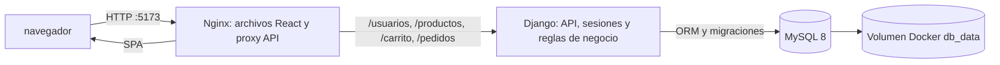

# LicoMart

LicoMart es una tienda web de licores creada como proyecto académico. Permite explorar un catálogo, filtrar productos, gestionar un carrito y consultar un panel administrativo para productos, inventario, pedidos y finanzas. Está pensada para ejecutarse localmente con Docker Compose; no es un despliegue de producción.

## Funcionalidades

- Catálogo con búsqueda por nombre o marca, categorías, rango de precios y ordenamiento combinables.
- Imágenes de productos servidas desde URLs externas, con alternativa visual cuando una imagen falla.
- Carrito con actualización de cantidades, eliminación de productos y vaciado.
- Registro e inicio de sesión para clientes.
- Panel administrativo en React con dashboard, gestión de productos, inventario, pedidos, pagos e ingresos y egresos.
- Validaciones y autorización de las operaciones administrativas en Django; las acciones de escritura usan protección CSRF.
- Historial de pedidos con precio unitario y total guardados, registro de movimientos de inventario y libro financiero.
- Comando opcional de datos de demostración idempotente.

Los pagos se confirman manualmente desde el panel: el proyecto no integra una pasarela de pago.

## Arquitectura



El frontend es una SPA de React y Nginx sirve los archivos compilados. Nginx reenvía las rutas de API al contenedor Django en el mismo origen, por lo que el navegador no necesita conectarse directamente a una IP interna de Docker. Django se conecta a MySQL mediante el ORM. El volumen `db_data` conserva la base entre reinicios de contenedores.

### Tecnologías

| Área                        | Tecnologías                                                                   |
| --------------------------- | ----------------------------------------------------------------------------- |
| Frontend                    | React 19, TypeScript, Vite, Tailwind CSS, Axios, React Router                 |
| Backend                     | Python 3.12, Django 4.2, Django REST Framework instalado, django-cors-headers |
| Persistencia                | MySQL 8, Django ORM y migraciones                                             |
| Contenedores y servidor web | Docker Compose, Nginx                                                         |

### Estructura principal

```text
backend/
  licomart/       Configuración y rutas principales de Django
  usuarios/       Cuentas de tienda y autenticación por sesión
  productos/      Productos, categorías, API y carga de productos demo
  carrito/        Operaciones del carrito y creación de pedidos
  pedidos/        Pedidos, pagos, movimientos y endpoints administrativos
frontend/
  src/pages/      Vistas de tienda y panel de administración
  src/components/ Componentes reutilizables de la interfaz
  src/services/   Comunicación HTTP con el backend
imgs/             Diagramas existentes
docker-compose.yml
```

## Requisitos para ejecutarlo localmente

- Windows 10/11 con Docker Desktop instalado y en ejecución, incluyendo Docker Compose.
- Git para clonar el repositorio.
- Puertos locales `5173`, `8000` y `3306` disponibles.

No es necesario instalar Python, Node.js ni MySQL en el equipo para ejecutar la aplicación con Docker.

## Inicio rápido en Windows PowerShell

Desde la carpeta del repositorio:

```powershell
docker compose up -d --build
docker compose ps
```

Espera a que `db`, `backend` y `frontend` aparezcan como `healthy`. El backend espera a que MySQL esté listo y ejecuta las migraciones al iniciar.

Abre:

- Tienda: [http://localhost:5173](http://localhost:5173)
- Panel React: [http://localhost:5173/admin](http://localhost:5173/admin), después de iniciar sesión con una cuenta cuyo rol sea `admin`.
- Django Admin: [http://localhost:8000/admin/](http://localhost:8000/admin/).

La tienda y Django Admin usan cuentas distintas. La cuenta de tienda `admin_demo` no permite iniciar sesión en Django Admin.

### Cargar datos de demostración

Si quieres poblar una base vacía o agregar los registros de demostración sin borrar los que ya existen:

```powershell
docker compose exec backend python manage.py cargar_datos_demo
```

La carga incluye productos de distintas categorías, pedidos, movimientos de inventario e ingresos y egresos ficticios. También crea `admin_demo` si no existe:

- Usuario de la tienda: `admin_demo`
- Contraseña local: `LicoMartDemo2026!`

Estas credenciales son únicamente para desarrollo local.

El comando es seguro de repetir: reconoce sus pedidos y movimientos mediante referencias y claves idempotentes, no vuelve a reservar el inventario de pedidos existentes y no modifica otros productos ni cuentas. El comando de productos también puede ejecutarse por separado:

```powershell
docker compose exec backend python manage.py cargar_productos_demo
```

Por defecto, los productos existentes se conservan. Existe una opción explícita para actualizar solo los productos demo originales reconocidos por sus nombres exactos:

```powershell
docker compose exec backend python manage.py cargar_productos_demo --actualizar-productos-demo-existentes
```

La opción conserva precio y stock; si un producto está ligado a pedidos, también preserva su nombre y descripción históricos. No limpia ni elimina registros.

### Comprobar la API del catálogo

El frontend y la API son accesibles desde el mismo puerto:

```powershell
curl.exe http://localhost:5173/productos/
curl.exe "http://localhost:5173/productos/?categoria=whisky&precio_max=70000&orden=precio_desc"
```

La respuesta del catálogo incluye `productos`, `categorias` y `total`. En la tienda también puedes probar búsqueda por nombre o marca y combinar filtros desde la interfaz.

### Detener y volver a iniciar

Detén los contenedores sin borrar la base de datos:

```powershell
docker compose down
```

Para volver a iniciarlos:

```powershell
docker compose up -d
```

No uses `docker compose down -v` si quieres conservar los datos: `-v` elimina el volumen de MySQL.

## Verificación y pruebas

Comprobaciones del backend:

```powershell
docker compose exec backend python manage.py check
docker compose exec backend python manage.py makemigrations --check --dry-run
docker compose exec -T -e DB_USER=root -e DB_PASSWORD=rootpassword backend python manage.py test
```

Lint y build del frontend (requieren Node.js instalado localmente):

```powershell
Set-Location frontend
npm ci
npm run lint
npm run build
Set-Location ..
```

En la última verificación del proyecto pasaron las 20 pruebas Django, `manage.py check`, la comprobación de migraciones y el build de producción de React/TypeScript. También se comprobó que la API respondiera y que los filtros de categoría, precio, orden y combinación devolvieran resultados coherentes.

## API principal

Las rutas de aplicación están bajo el mismo origen (`http://localhost:5173`):

| Ruta                                                                                 | Uso                                    |
| ------------------------------------------------------------------------------------ | -------------------------------------- |
| `/usuarios/login/`, `/usuarios/register/`, `/usuarios/logout/`, `/usuarios/me/`      | Sesión y cuentas de la tienda          |
| `/productos/`                                                                        | Catálogo, categorías y filtros         |
| `/carrito/`                                                                          | Operaciones del carrito                |
| `/pedidos/`                                                                          | Pedidos y consultas relacionadas       |
| `/pedidos/admin/dashboard/`                                                          | Resumen administrativo protegido       |
| `/pedidos/admin/productos/`, `/pedidos/admin/inventario/`                            | Productos e inventario                 |
| `/pedidos/admin/pedidos/`, `/pedidos/admin/finanzas/`, `/pedidos/admin/movimientos/` | Operaciones administrativas protegidas |
| `/admin/` en el puerto `8000`                                                        | Interfaz nativa de Django Admin        |

La autorización del panel React se valida también en el backend. Ocultar una ruta en el frontend no se considera un control de permisos suficiente.

## Capturas para el portafolio

El repositorio incluye diagramas de base de datos, casos de uso y actividades. Para mostrar la aplicación, agrega capturas propias del catálogo, filtros, carrito y panel administrativo dentro de `imgs/` y enlázalas desde este README, por ejemplo:

```markdown

```

Comprueba que las imágenes se lean en tema claro y oscuro, que no incluyan datos personales ni credenciales y que se hayan añadido al repositorio junto con el README.

## Diagramas

### Modelo de base de datos


### Casos de uso


### Actividades


## Alcance y seguridad

Este repositorio está configurado para desarrollo local. La configuración actual de Compose habilita `DEBUG` y usa credenciales de base de datos de desarrollo; el backend ejecuta `runserver`, que no es un servidor de producción.
