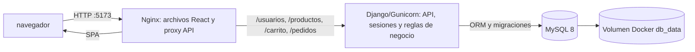

# LicoMart

LicoMart es una tienda web de licores creada como proyecto académico. Permite explorar un catálogo, filtrar productos, gestionar un carrito y consultar un panel administrativo para productos, inventario, pedidos y finanzas. Está pensada para ejecutarse localmente con Docker Compose; no es un despliegue de producción.

## Tecnologías

| Área | Tecnologías |
| --- | --- |
| Frontend | React 19, TypeScript, Vite 7, Tailwind CSS v4, Axios, React Router 7 |
| Gráficas | Chart.js, react-chartjs-2 |
| Backend | Python 3.12, Django 5.2, Django REST Framework, django-cors-headers |
| Base de datos | MySQL 8 (PyMySQL) |
| Servidor web | Nginx (proxy inverso + SPA), Gunicorn (WSGI) |
| Contenedores | Docker, Docker Compose |
| Notificaciones | react-hot-toast |
| Íconos | react-icons |

## Requisitos

- Docker Desktop instalado y en ejecución (incluye Docker Compose).
- Git para clonar el repositorio.
- Puertos `5173`, `8000` y `3306` disponibles.

No es necesario instalar Python, Node.js ni MySQL en el equipo.

## Inicio rápido

Clona el repositorio y ejecuta el comando de inicio desde la carpeta del proyecto. **Al terminar de levantar los servicios, la consola mostrará la URL de acceso y las credenciales de administrador y usuario para probar la aplicación.**

### Windows (PowerShell)

```powershell
.\iniciar.ps1
```

### Linux / macOS (Bash)

```bash
./iniciar.sh
```

El comando construye los contenedores, carga datos de demostración (categorías, productos, pedidos, movimientos financieros) y muestra en consola:

- La URL de la aplicación
- El usuario y contraseña del rol **admin**
- El usuario y contraseña del rol **usuario**

Si ya tienes datos y no quieres que se borren y recarguen, usa la bandera `--no-seed`:

```powershell
.\iniciar.ps1 -NoSeed
```

```bash
./iniciar.sh --no-seed
```

## Arquitectura



El frontend es una SPA de React y Nginx sirve los archivos compilados. Nginx reenvía las rutas de API al contenedor Django (Gunicorn) en el mismo origen. Django se conecta a MySQL mediante el ORM. El volumen `db_data` conserva la base entre reinicios de contenedores.

### Estructura principal

```text
backend/
  licomart/       Configuración y rutas principales de Django
  usuarios/       Cuentas de tienda y autenticación por sesión
  productos/      Productos, categorías y API del catálogo
  carrito/        Operaciones del carrito
  pedidos/        Pedidos, pagos, movimientos y endpoints administrativos
frontend/
  src/pages/      Vistas de tienda y panel de administración
  src/components/ Componentes reutilizables de la interfaz
  src/services/   Comunicación HTTP con el backend
docker-compose.yml
iniciar.sh        Script de inicio (Bash)
iniciar.ps1       Script de inicio (PowerShell)
```

## Funcionalidades

- Catálogo con búsqueda por nombre o marca, categorías, rango de precios y ordenamiento.
- Carrito con actualización de cantidades, eliminación de productos y vaciado.
- Registro e inicio de sesión para clientes.
- Panel administrativo con dashboard (gráficas de ventas, KPIs, top productos), gestión de productos, inventario, pedidos y finanzas.
- Protección CSRF en todas las operaciones de escritura.
- Historial de pedidos con precio unitario y total, movimientos de inventario y libro financiero.
- Datos de demostración cargados automáticamente al iniciar.

Los pagos se confirman manualmente desde el panel: el proyecto no integra una pasarela de pago.

## Detener y volver a iniciar

```powershell
docker compose down        # Detiene sin borrar datos
docker compose up -d       # Vuelve a iniciar
```

No uses `docker compose down -v` si quieres conservar los datos: `-v` elimina el volumen de MySQL.

## Diagramas

### Modelo de base de datos


### Casos de uso


### Actividades


## Alcance y seguridad

Este repositorio está configurado para desarrollo local. La configuración de Compose usa credenciales de base de datos de desarrollo. La autorización del panel React se valida también en el backend.
